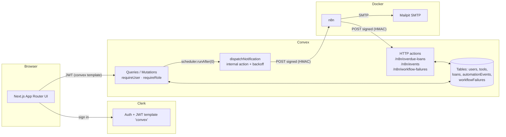
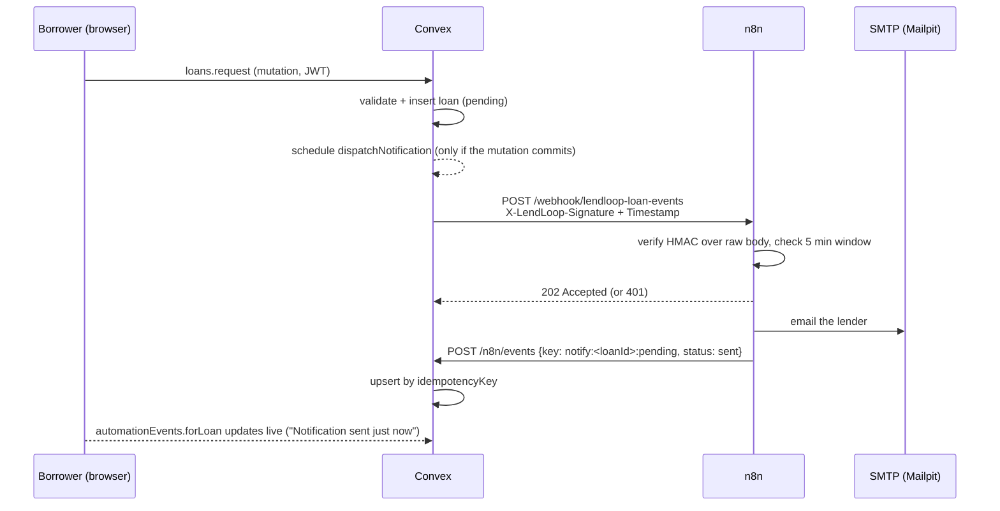
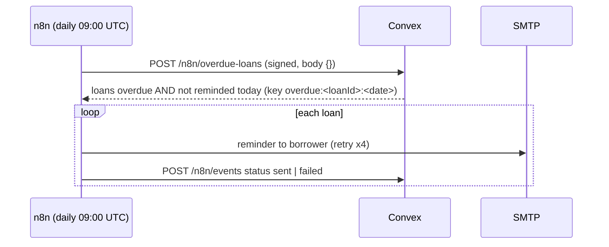
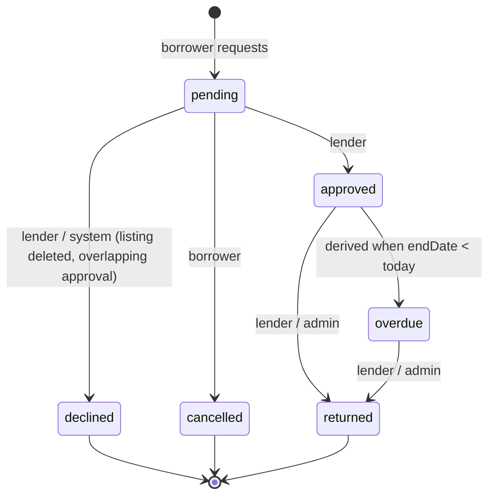

# LendLoop

> **Borrow what you need. Lend what you don't.**

A neighbourhood tool-lending board. Neighbours list tools, request to borrow them for a date range, and get automated notifications and overdue reminders through n8n.

**Stack:** Next.js 15 (App Router) · TypeScript (strict) · Clerk · Convex · n8n (Docker) · Tailwind CSS v4 · Vitest + convex-test

---

## Contents

1. [What it does](#what-it-does)
2. [Screenshots](#screenshots)
3. [Architecture](#architecture)
4. [Local setup, step by step](#local-setup-step-by-step)
5. [Environment variables](#environment-variables)
6. [Loan state machine](#loan-state-machine)
7. [RBAC design](#rbac-design)
8. [Security and data minimisation](#security-and-data-minimisation)
9. [Automation: idempotency, retries and error handling](#automation-idempotency-retries-and-error-handling)
10. [Design decisions](#design-decisions)
11. [Testing](#testing)
12. [Project structure](#project-structure)
13. [What I'd change for production](#what-id-change-for-production)
14. [Verification status](#verification-status)

---

## What it does

**Signed out:** the landing page shows the name, the tagline and a read-only list of currently available tools (name and category only), plus a "Sign in to lend or borrow" button that opens Clerk.

**Signed in:**

| View | What you can do |
| --- | --- |
| **Browse** | All tools with live availability (available / requested / on loan), filterable by category. Request to borrow for a date range. Trusted Lender badges. |
| **My listings** | List a tool (name, category, condition, description), edit it, delete it. |
| **My requests** | Your borrow requests with status (including derived **overdue**), cancel while pending, and automation activity ("Notification sent 2 hours ago"). |
| **Incoming** | Requests for your tools: approve, decline, mark returned. |
| **Admin** (admins only) | All loans, remove any listing, toggle Trusted Lender, failed automations. |

**Automation (n8n):**

1. **Request notification:** every status change on a loan triggers a signed webhook to n8n, which emails the right person and writes the result back to Convex.
2. **Overdue reminders:** a daily workflow asks Convex for overdue loans, emails each borrower and writes back the reminder status.
3. **Error handler:** any failed run is recorded in Convex (visible on the admin page) and emailed to operators.

## Screenshots

I could not capture screenshots from the build environment: it can't reach Clerk or Convex cloud, so the authenticated UI never renders there. To add them after running locally:

```bash
mkdir -p docs/screenshots   # then save: landing.png, board.png, incoming.png, admin.png
```

and reference them here, for example ``.

## Architecture



**Request notification sequence**



**Overdue reminder sequence**



## Local setup, step by step

**Prerequisites:** Node 20+ (CI uses 22), Docker, a free [Clerk](https://clerk.com) account, a free [Convex](https://convex.dev) account, and a tunnel tool such as `cloudflared` or `ngrok`. Convex functions run in Convex's cloud, so they need a public URL to reach the n8n container on your machine.

### 1. Install

```bash
git clone <this repo> lendloop && cd lendloop
npm install
cp .env.example .env.local
```

### 2. Clerk

1. Create an application in the Clerk dashboard (email sign-in is enough).
2. Copy the **Publishable key** and **Secret key** into `.env.local` (`NEXT_PUBLIC_CLERK_PUBLISHABLE_KEY`, `CLERK_SECRET_KEY`).
3. **JWT templates → New template → Convex.** Keep the name `convex`. The preset includes `email`, `name` and `email_verified`, which the backend reads. If your template lacks `email_verified`, add `"email_verified": "{{user.email_verified}}"`, otherwise nobody can become admin (by design). Copy the **Issuer** URL (for example `https://your-app.clerk.accounts.dev`).

### 3. Convex

```bash
npx convex dev          # log in, create a project; writes CONVEX_DEPLOYMENT + NEXT_PUBLIC_CONVEX_URL to .env.local
```

Leave it running (it pushes functions and regenerates `convex/_generated`). In another terminal, set the server env vars:

```bash
npx convex env set CLERK_JWT_ISSUER_DOMAIN https://your-app.clerk.accounts.dev
npx convex env set ADMIN_EMAILS you@example.com
npx convex env set LENDLOOP_WEBHOOK_SECRET "$(openssl rand -hex 32)"   # note the value, n8n needs the same one
npx convex env get LENDLOOP_WEBHOOK_SECRET
```

`N8N_WEBHOOK_URL` gets set in step 4, once the tunnel URL is known.

Your Convex **HTTP actions URL** is the deployment URL with `.convex.site` instead of `.convex.cloud`. You need it for n8n.

### 4. n8n + Mailpit (Docker)

Create `.env` (docker compose reads it) with at least:

```bash
N8N_ENCRYPTION_KEY=<openssl rand -hex 32>
LENDLOOP_WEBHOOK_SECRET=<same value as in Convex>
CONVEX_SITE_URL=https://your-deployment-name.convex.site
N8N_PUBLIC_URL=https://<your-tunnel-host>/
```

Start the tunnel and the stack:

```bash
cloudflared tunnel --url http://localhost:5678     # prints https://<random>.trycloudflare.com
docker compose up -d
```

Then:

1. Open http://localhost:5678 and create the n8n owner account.
2. Import and activate the workflows: `./n8n/import.sh`. CLI import keeps the workflow ids, so the Error Workflow link already works.
   *Alternatively*, in the UI use **Import from file** for each JSON in `n8n/workflows/`. Then set **Settings → Error workflow → LendLoop: Error handler** on the two main workflows, and activate them.
3. **Create the credential** (it is not in the exports): **Credentials → New → SMTP**, name it exactly **`LendLoop SMTP`**. Host `mailpit`, port `1025`, SSL/TLS off, no user or password. Open each workflow once and make sure the email nodes show this credential. Re-select it if n8n asks.
4. Point Convex at the production webhook:

```bash
npx convex env set N8N_WEBHOOK_URL https://<your-tunnel-host>/webhook/lendloop-loan-events
```

Mailpit's inbox is at http://localhost:8025.

### 5. Run the app

```bash
npm run dev           # Next.js on :3000 and `convex dev` together
```

### 6. Try the full loop

1. Sign in with the email from `ADMIN_EMAILS` (the Admin tab appears) and list a tool.
2. In a private window, sign in as a second user and request the tool.
3. Mailpit shows the lender's email. Under **Incoming**, the request shows *"Notification sent just now"* (written back by n8n).
4. Approve it. The borrower gets an email.
5. Overdue reminder: backdate the loan, then run the workflow manually:
   ```bash
   npx convex env set ALLOW_DEV_TOOLS true
   npx convex run dev:backdateLoan '{"loanId":"<loan id from the dashboard>","startDate":"2026-01-01","endDate":"2026-01-02"}'
   ```
   In n8n, open **LendLoop: Overdue reminders → Test workflow**. The borrower gets a reminder, and **My requests** shows *Overdue* and *"Reminder sent just now"*. Run it again: nothing is sent, because the loan was already reminded today.
6. Failure path: stop Mailpit (`docker compose stop mailpit`) and approve another request. After the retries, the admin page lists a failed notification.

## Environment variables

| Variable | Where | Purpose |
| --- | --- | --- |
| `NEXT_PUBLIC_CLERK_PUBLISHABLE_KEY` | Next.js | Clerk frontend key (public by design) |
| `CLERK_SECRET_KEY` | Next.js (server) | Clerk middleware / server SDK |
| `NEXT_PUBLIC_CONVEX_URL` | Next.js | Convex client URL (public) |
| `CONVEX_DEPLOYMENT` | Convex CLI | Which deployment `convex dev` targets |
| `CONVEX_DEPLOY_KEY` | CI only | `npx convex deploy` in pipelines |
| `CLERK_JWT_ISSUER_DOMAIN` | Convex env | Trust Clerk JWTs (`convex/auth.config.ts`) |
| `ADMIN_EMAILS` | Convex env | Comma-separated admin allowlist (verified emails only) |
| `N8N_WEBHOOK_URL` | Convex env | n8n production webhook for loan events |
| `LENDLOOP_WEBHOOK_SECRET` | Convex env **and** n8n env | Shared HMAC secret, both directions |
| `ALLOW_DEV_TOOLS` | Convex env (dev only) | Enables `dev:backdateLoan` |
| `N8N_ENCRYPTION_KEY` | docker `.env` | Encrypts n8n credentials at rest |
| `N8N_PUBLIC_URL` | docker `.env` | Public base URL n8n uses for webhooks |
| `CONVEX_SITE_URL` | docker `.env` | Base URL of Convex HTTP actions (`.convex.site`) |
| `LENDLOOP_APP_URL` | docker `.env` | Links inside emails |
| `LENDLOOP_MAIL_FROM` | docker `.env` | Sender address |
| `LENDLOOP_ALERT_EMAIL` | docker `.env` | Where the Error Workflow sends alerts (optional) |
| `SMTP_HOST` / `SMTP_PORT` / `SMTP_USER` / `SMTP_PASSWORD` / `SMTP_SECURE` | n8n credential | Values for the `LendLoop SMTP` credential (Mailpit locally) |

No secret is ever prefixed `NEXT_PUBLIC_`. The browser bundle only contains the Clerk publishable key and the Convex URL, both public by design.

## Loan state machine



- Transitions and **who may perform them** live in one table in `convex/lib/stateMachine.ts`. Every mutation calls `assertTransition(from, to, actor)`. The UI only mirrors it.
- **`overdue` is derived, not stored**: it is `approved` with `endDate < today (UTC)`. Storing it would need a cron to flip it, and that creates a second source of truth that can drift from the dates.
- Server-side request validation: valid ISO dates, `start <= end`, start not in the past, at most 60 days, not your own tool, no overlap with an **approved** loan, and no duplicate pending request. Approval re-checks the overlap, because two pending requests may overlap. The first approval wins, and the overlapping ones are auto-declined, with notifications.

## RBAC design

- **Identity:** Clerk issues a JWT from the `convex` template. Convex verifies it (`auth.config.ts`), so `ctx.auth.getUserIdentity()` is trustworthy.
- **Users table:** `users.syncCurrentUser` runs right after sign-in (from `CurrentUserGate`). It upserts `{clerkId, email, name, role, trustedLender}` from the JWT claims, never from client arguments.
- **Admin bootstrap:** `role = admin` only if the email is in `ADMIN_EMAILS` **and** `email_verified` is true. Without the verified check, anyone could sign up with an admin's address on an instance that allows unverified emails. The role is recomputed on every sync, so removing an email demotes that admin. Nothing is hard-coded.
- **Helpers** (`convex/lib/auth.ts`): `requireUser(ctx)`, `requireRole(ctx, "admin")`, `requireOwnedTool(ctx, toolId, userId)`. Every public function that touches private data starts with one of them.
- **Ownership on every write:** tool edits and deletes go through `requireOwnedTool`. Loan actions resolve the caller's relationship to the loan (`lender` / `borrower` / `admin`), and the state machine decides whether that actor may make the transition.
- **No existence oracle:** unrelated users get `NOT_FOUND` rather than `FORBIDDEN`, so they cannot tell whether an id exists.
- **Admin:** `admin.*` functions (all loans, all tools, users, remove listing, Trusted Lender, failed automations) each call `requireRole(ctx, "admin")`. Hiding the Admin tab is cosmetic.
- **Defence in depth:** Clerk middleware redirects signed-out users away from app routes, but the data is protected even if a route slipped through.
- **Internal functions:** dispatch, write-back and dev helpers are `internal*`, which the browser cannot call. They are reachable only through signed HTTP endpoints or deployment credentials.

**Why I used sign-in sync instead of a Clerk webhook:** it removes a public endpoint and a moving part, and the data comes from the same verified JWT. The cost is that profile changes only sync on the next sign-in, and a user deleted in Clerk keeps a stale row. For production I'd add the `user.updated` / `user.deleted` webhook, verified with svix, mainly for GDPR erasure (see below).

## Security and data minimisation

**Integration security (both directions)**

- Every Convex → n8n and n8n → Convex request carries `X-LendLoop-Timestamp` (unix seconds) and `X-LendLoop-Signature: sha256=<hex>`, where the signature is `HMAC-SHA256(secret, "<timestamp>.<raw body>")`.
- The receiver verifies over the **raw** body (before parsing JSON), compares in **constant time**, and rejects timestamps more than **5 minutes** off (replay protection). The timestamp is part of the signed message, so it cannot be swapped.
- **Fails closed:** a missing secret rejects everything (`NO_SECRET`) rather than accepting everything.
- Convex HTTP endpoints also cap the body at 16 KB, validate shape with zod, and return a generic `401` (the precise reason is only logged).
- A write-back may only touch the loan its idempotency key names (`keyMatchesLoan`), and unknown loan ids are refused (`422`).
- The same signing code (`convex/lib/signature.ts`, Web Crypto only) runs in Convex, in the tests, and (as a byte-identical Node `crypto` port) in the n8n Code nodes. A unit test checks the two implementations agree.

**Secrets**

- Only in env vars (Convex env, `.env.local`, docker `.env`) and n8n credentials. `.env*` is git-ignored except `.env.example`.
- Workflow exports reference the SMTP credential **by name** and contain no secret values. CI greps the exports to keep it that way.
- n8n reads `LENDLOOP_WEBHOOK_SECRET` from its container environment (`$env`), so the secret is never stored in a workflow. Trade-off: this requires `N8N_BLOCK_ENV_ACCESS_IN_NODE=false`, so anyone who can *edit* workflows can read env vars. That is acceptable for a single-owner instance. In production I'd move signing into a custom credential type or a small signing sidecar.

**Data minimisation**

- `tools.listPublic` returns **exactly** `{ name, category }` for available tools: no ids, owner or description. A test asserts the key set.
- Signed-in neighbours see an owner's **display name** and Trusted badge, never their email. Booked date ranges are shown without saying who booked them.
- The n8n payload contains only what is needed to send one message: `loanId, eventType, status, idempotencyKey, recipientRole, recipient {email, name}, toolName, startDate, endDate`. Only the recipient's details are included, never both parties'. A test asserts the borrower's email is absent from the lender's notification.
- The Error Workflow forwards workflow name, execution id, last node and error message, with no payload data.
- n8n prunes execution data after 14 days (`EXECUTIONS_DATA_MAX_AGE`).

**Web app**

- Security headers in `next.config.ts`: CSP restricted to self + Clerk + Convex + Turnstile, HSTS, `X-Frame-Options: DENY` / `frame-ancestors 'none'`, `nosniff`, a strict referrer policy, a Permissions-Policy, and no `X-Powered-By`.
- Error messages shown to users come only from deliberate `ConvexError` payloads. Unexpected errors show a generic message.

## Automation: idempotency, retries and error handling

| Concern | Design |
| --- | --- |
| **Idempotency keys** | Deterministic: `notify:<loanId>:<status>` (statuses only move forward, so each is reached at most once) and `overdue:<loanId>:<YYYY-MM-DD>` (at most one reminder per loan per day). |
| **Upsert** | `automationEvents` has a `by_idempotencyKey` index. Write-backs upsert: none → insert, `failed` → update (a retry succeeded), `sent` → no-op (never duplicated or downgraded). Convex mutations are serializable transactions, so concurrent write-backs with the same key cannot both insert. |
| **No double reminders** | `/n8n/overdue-loans` excludes loans whose key for *today* is already `sent`. Re-running the workflow, or n8n retrying the whole execution, sends nothing new. |
| **No duplicate notifications** | `dispatchNotification` checks the key first and skips if already `sent`. |
| **Convex → n8n retries** | The action is scheduled from the mutation, so it runs only if the mutation commits and never blocks the user. On network errors, timeouts (10 s), 5xx, 408 or 429 it reschedules itself with **exponential backoff + jitter** (waits of 1–2 s, 2–4 s, 4–8 s, 8–16 s; capped at 5 min; 5 attempts total). Other 4xx responses (bad signature, bad payload) are not retried, because they won't fix themselves. Missing configuration is recorded rather than skipped. |
| **n8n retries** | HTTP Request and Send Email nodes use `retryOnFail` (4 tries, 3 s apart; n8n's built-in retry is fixed-interval). Signed write-backs stay within the 5 min window across retries. |
| **Per-item failures** | Email nodes use the **error output**: a failed send writes back `status: failed` with the error for that loan, so one bad address doesn't stop the batch. |
| **Whole-run failures** | Both workflows set **LendLoop: Error handler** as their Error Workflow. It logs to the container, records the failure in Convex (`workflowFailures`, one row per execution id), and emails `LENDLOOP_ALERT_EMAIL`. |
| **Visibility** | The admin page lists failed `automationEvents` and failed workflow runs. Each loan shows its recent activity ("Reminder sent 2 days ago" / "Notification failed"). |

**Delivery semantics:** at-least-once. If n8n sends the email but the write-back is lost and Convex retries, the person may get the same email twice. Exactly-once would need n8n to claim the key in Convex before sending (a two-phase "claim → send → confirm"). I left that out to keep the workflows readable, and noted it below.

## Design decisions

- **Only the lender (or an admin) can mark a loan returned.** The lender is the one who has the tool back. If borrowers could self-certify, a borrower could clear an overdue state without returning anything. Admins can resolve disputes.
- **Dates are ISO calendar dates (`YYYY-MM-DD`)**, not timestamps: a loan is a range of days. ISO strings compare correctly as strings, so overlap and overdue checks are simple and index-friendly (`by_status_endDate`).
- **"Not in the past" uses the earliest timezone on Earth (UTC-12).** Without trusting a client-supplied timezone, this rejects only dates that are in the past for *everyone*. It avoids refusing "today" for someone whose local date is behind UTC. Overdue uses UTC.
- **Soft delete for tools** (`deletedAt`), so loan history keeps its tool name. Deleting declines pending requests (with notifications). Owners cannot delete a tool that is currently lent out; admins can, for moderation, and the loan stays returnable.
- **Availability** is computed from open loans: *on loan* if an approved loan has started (including overdue), *requested* if any request is pending, otherwise *available*. A future booking does not hide a tool, because its booked ranges are shown instead.
- **Public list shows available tools only**, matching "list of available tools".
- **Bounded queries:** lists use `.take(n)` on indexes (200–300 rows). That is fine for a neighbourhood; production would paginate.

## Testing

```bash
npm test            # 70 tests: unit + Convex integration
npm run typecheck   # Next.js and Convex projects
npm run lint
```

| Suite | Covers |
| --- | --- |
| `tests/unit/signature.test.ts` | Signing format, a known HMAC vector cross-checked against Node `crypto` (as used in n8n), tampered body, wrong secret, stale/future timestamps, timestamp swapping, missing secret (fail closed), malformed headers, constant-time compare |
| `tests/unit/stateMachine.test.ts` | Exhaustive check of every (from, to, actor) combination against the allow-list, error kinds, terminal states, derived overdue |
| `tests/unit/dates.test.ts` | ISO validation, past/UTC-12 rule, max length, inclusive overlap (symmetric), availability |
| `tests/unit/automation.test.ts` | Idempotency keys, key/loan binding, upsert decisions, backoff bounds, recipient selection, RBAC helpers (allowlist parsing, verified-only admin, role hierarchy) |
| `tests/convex/rbac.test.ts` | Signed-out rejection, public query field set, admin bootstrap and demotion, ownership on edit/delete, server-side validation, unrelated users, admin-only functions |
| `tests/convex/loans.test.ts` | Request validation, approved-overlap rule, full lifecycle, forbidden actors, auto-decline of overlapping requests, derived overdue, delete rules, category filter |
| `tests/convex/automation.test.ts` | Signed minimal dispatch payload, retry with backoff then `failed`, no retry on 401, unconfigured webhook, skip-if-sent, idempotent write-backs through the real HTTP router, signature rejections, key/loan mismatch, overdue endpoint once-per-day, workflow failure dedupe |

Convex tests use `convex-test` in the `edge-runtime` environment (close to Convex's V8 runtime), with fake timers so scheduled retries run deterministically.

CI (`.github/workflows/ci.yml`) runs lint, both typechecks, tests, a JSON + no-secrets check on the n8n exports, and a production build.

## Project structure

```
app/                     Next.js routes
  page.tsx               public landing (listPublic)
  (app)/                 signed-in area: tools, listings, requests, incoming, admin
components/              UI: providers (Convex+Clerk, CurrentUserGate), tools, loans, ui primitives
convex/
  schema.ts              tables + indexes
  lib/                   pure logic: auth, stateMachine, dates, signature, automation, validators
  tools.ts loans.ts users.ts admin.ts automationEvents.ts
  automation.ts          dispatch action, write-back upsert, overdue query
  http.ts                signed n8n endpoints
  dev.ts                 internal dev helper (backdate a loan)
lib/                     client helpers (errors, formatting, mutation state)
n8n/workflows/*.json     exported workflows (no credentials)
n8n/import.sh            CLI import + activation
tests/                   unit/ and convex/ suites
docker-compose.yml       n8n + Mailpit with persistent volumes
```

## What I'd change for production

- **n8n:** managed n8n Cloud, or self-hosted in **queue mode** (Redis + workers) on Postgres instead of SQLite, with separate webhook processors. Move HMAC signing out of `$env` into a custom credential or a signing sidecar, and re-enable `N8N_BLOCK_ENV_ACCESS_IN_NODE`.
- **Exactly-once notifications:** claim the idempotency key in Convex before sending, or use an email provider that supports idempotency keys.
- **Secret rotation:** accept two secrets during a rotation window (`LENDLOOP_WEBHOOK_SECRET` and `..._PREVIOUS`) and add a key id header. Rotate Clerk/Convex keys through the secrets manager.
- **Rate limiting:** per-user limits on mutations, such as request creation (for example with `@convex-dev/rate-limiter`), and IP limits on the HTTP endpoints.
- **Audit log:** an append-only `auditLog` table recording who changed what, when (admin removals, Trusted Lender changes, every loan transition).
- **Observability:** Sentry for the Next.js app and Convex (exception reporting), Datadog/OpenTelemetry for logs and metrics (dispatch latency, failure rate, retry counts), alerts on `workflowFailures` and failed events.
- **CSP / headers:** nonce-based CSP via middleware (drop `'unsafe-inline'` for scripts), with CSP reporting.
- **Backups:** scheduled Convex exports (`npx convex export`) plus n8n's Postgres backups and an encrypted copy of `N8N_ENCRYPTION_KEY`.
- **GDPR / data retention:** a Clerk `user.deleted` webhook (verified with svix) that anonymises the user and their loans. Retention windows for loans and automation events. A data export endpoint.
- **Pagination** for every list (`usePaginatedQuery`), plus search.
- **Testing:** Playwright e2e tests in CI against a preview Convex deployment and Clerk test users, plus an n8n workflow smoke test in CI (see below).
- **Clerk webhook** for profile updates, so names and emails don't wait for the next sign-in.
- **Email:** a transactional provider (Postmark, SES) with SPF/DKIM, HTML templates and unsubscribe handling.

## Verification status

**Verified here (automatically):**

- `npm run lint`, `npm run typecheck` (both projects), `npm test` (70 tests) and `next build` all pass.
- **The n8n workflows were imported and executed on a real n8n 1.123.96** (installed from npm), against a mock of the three Convex HTTP endpoints that uses this repo's `verifySignature`, and a local SMTP sink:
  - a signed event → `202`, email delivered, signed write-back `sent` accepted by the mock;
  - tampered body, wrong secret and stale timestamp → `401`, nothing sent;
  - SMTP down → email node retried, then wrote back `failed` with the error;
  - Convex write-back failing → HTTP retries, then the **Error Workflow** fired, recorded the failure (workflow, execution id, failing node) and emailed the alert;
  - overdue workflow with two loans → two reminders and two `sent` write-backs; empty list → clean run.

**Not verified end to end here** (the build environment can't reach Clerk, Convex cloud or container registries):

- Real Clerk sign-in and the `convex` JWT template claims (especially `email_verified`) reaching Convex.
- Deploying to a real Convex deployment. `convex/_generated` was written by hand to match what `convex dev` generates, and `npx convex dev` overwrites it on your machine. The functions themselves ran under `convex-test`.
- The Docker images: `docker compose up` was not run (registries blocked). The n8n image tag pins the version I tested via npm. Mailpit replaced the local SMTP sink.
- Convex cloud → n8n over a tunnel (real network path).
- The UI in a browser (rendering, accessibility checks, screenshots).
